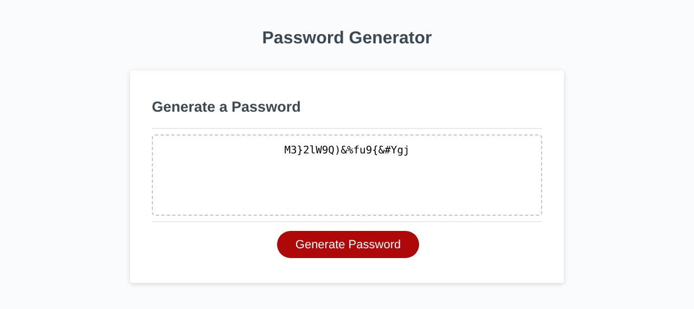

<h1 align="center">🔐 Super Secure Password Generator</h1>

<p align="center">Generate a strong random password from the length and character types you choose.</p>

<p align="center">
  
  
  
</p>

<p align="center"></p>

## Features

- Choose a password length from 8 to 128 characters
- Choose which character types to include:
  - Uppercase letters
  - Lowercase letters
  - Numbers
  - Special characters
- Requires at least one character type to be selected
- Every password includes at least one character from each type you selected, then shuffles the result
- The password appears in the text box, ready to copy

## Built With

- HTML, CSS, JavaScript
- [rando.js](https://randojs.com/) for random selection and shuffling

## Running Locally

No build step is needed.

1. Clone the repo:
   ```bash
   git clone https://github.com/ChristianKrantz11/super-secure-password-generator.git
   ```
2. Open `index.html` in your browser.
3. Click **Generate Password** and answer the prompts.

## Known Issues

The top of `script.js` contains leftover starter code that logs a console error when the page loads:

- `window.getElementById(...)` should be `document.getElementById(...)`
- `writePassword` calls `generatePassword()`, which doesn't exist

The **Generate Password** button still works, because it calls `generateNewPassword()` directly.

## Author

[ChristianKrantz11](https://github.com/ChristianKrantz11)
